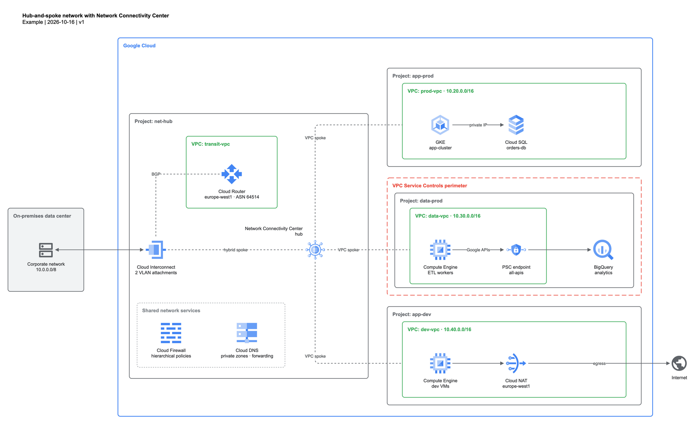

# Google Cloud Architecture Diagram Skill

[](https://github.com/EBMBA/gcp-architecture-diagram-skill/actions/workflows/ci.yml)
[](LICENSE)

An agent skill (Claude Code and other agents supporting `SKILL.md`) that generates **Google Cloud
architecture diagrams** as native, editable **draw.io** files, using the **official Google Cloud
product icons**. Inspired by [vidanov/aws-architecture-diagram-skill](https://github.com/vidanov/aws-architecture-diagram-skill).



*Hub-and-spoke network with Network Connectivity Center, rendered in `legacy` icon mode.* More in
[`examples/`](skills/gcp-architecture-diagram/examples): a Cloud Run web app and GKE with hybrid connectivity (default `modern` icons),
each with its source, rendering and companion guide.

## What it does

- Writes `.drawio` files with the official icons **embedded** (no external dependency: the file opens in
  draw.io desktop, app.diagrams.net, VS Code, Confluence…).
- Follows Google's **2025 icon system**: 19 core products with their own 4-color icon, every other
  product with its category icon. A **`legacy` mode** uses the pre-2025 per-product icons instead.
- Knows GCP's **boundary rules** (global VPC, regional subnets, serverless outside the VPC, VPC-SC
  perimeters…), not AWS's.
- **Validates the layout** with a script, not by "mental check": overlapping icons, floating edges, edges
  through icons or labels, more than one bend, near-miss alignments, children outside their container.
- Exports to PNG / SVG / PDF with the diagram embedded (still editable).

## How it works

The agent writes a diagram with short placeholder styles; the script does the rest.

```xml
<mxCell id="run" value="Cloud Run&lt;br&gt;orders-api" style="gcpIcon=cloud_run;" vertex="1" parent="prj">
<mxCell id="vpc" value="VPC: shop-vpc" style="gcpGroup=vpc;" vertex="1" parent="prj">
<mxCell id="user" value="Customer" style="gcpShape=user;" vertex="1" parent="1">
```

```bash
# SCRIPT = <skill directory>/scripts/gcp_drawio.py
python3 SCRIPT fetch                       # once: download Google's icon packs
python3 SCRIPT build diagram.src.drawio    # -> diagram.drawio: embed icons + validate (--mode legacy)
python3 SCRIPT export diagram.drawio -f png
python3 SCRIPT list sql                    # find icon keys
```

## Install

```bash
# with the skills CLI
npx skills add EBMBA/gcp-architecture-diagram-skill

# or manually (Claude Code): the skill is the skills/gcp-architecture-diagram folder
git clone https://github.com/EBMBA/gcp-architecture-diagram-skill ~/src/gcp-architecture-diagram-skill
ln -s ~/src/gcp-architecture-diagram-skill/skills/gcp-architecture-diagram ~/.claude/skills/gcp-architecture-diagram

# then, once
python3 ~/.claude/skills/gcp-architecture-diagram/scripts/gcp_drawio.py fetch
```

Requirements: Python 3.9+ (standard library only). For exports: [draw.io desktop](https://github.com/jgraph/drawio-desktop/releases)
(`brew install --cask drawio` on macOS); set `DRAWIO_BIN` if it is not on a standard path.

Then ask your agent things like *"Draw a GCP architecture for a Cloud Run API with Cloud SQL and a
Pub/Sub → BigQuery analytics pipeline"*.

## Repository layout

Only `skills/gcp-architecture-diagram/` is installed; everything else is for the project.

| Path | Content |
|---|---|
| `skills/gcp-architecture-diagram/SKILL.md` | Instructions the agent follows |
| `skills/gcp-architecture-diagram/references/` | `icon-map.json` (product → icon mapping, aliases), `icons.md` (generated key list), `gcp-hierarchy.md` (boundary rules) |
| `skills/gcp-architecture-diagram/scripts/gcp_drawio.py` | fetch, build, validate, export, list, sheet, docs |
| `skills/gcp-architecture-diagram/assets/generic/` | Generic shapes (user, browser, server…) from Material Symbols |
| `skills/gcp-architecture-diagram/examples/` | Source diagrams (`*.src.drawio`) and their guides |
| `docs/images/` | Rendered examples (README, guides) |
| `tests/` | `python3 -m unittest discover -s tests` |

## Icons and licensing

- The skill's code is MIT licensed.
- **Google Cloud icons are not included in this repository.** `fetch` downloads them from Google's
  official icon page (https://cloud.google.com/icons) into `~/.cache/gcp-architecture-diagram/icons`
  (override with `GCP_ICONS_DIR`). Their use is subject to Google's terms; Google Cloud product names and
  icons are trademarks of Google LLC. This project is not affiliated with or endorsed by Google.
- Generic shapes in `skills/gcp-architecture-diagram/assets/generic/` come from [Material Symbols](https://github.com/google/material-design-icons)
  (Apache 2.0); see its `NOTICE.md`.

## Updating the icon map

When Google updates its icon packs or guide:

```bash
cd skills/gcp-architecture-diagram
python3 scripts/gcp_drawio.py fetch --force   # re-download, reports any missing file
python3 scripts/gcp_drawio.py sheet -o /tmp/sheet.drawio && python3 scripts/gcp_drawio.py export /tmp/sheet.drawio
python3 scripts/gcp_drawio.py docs            # regenerate references/icons.md
```

## Contributing

See [CONTRIBUTING.md](CONTRIBUTING.md). Changes are listed in [CHANGELOG.md](CHANGELOG.md).
