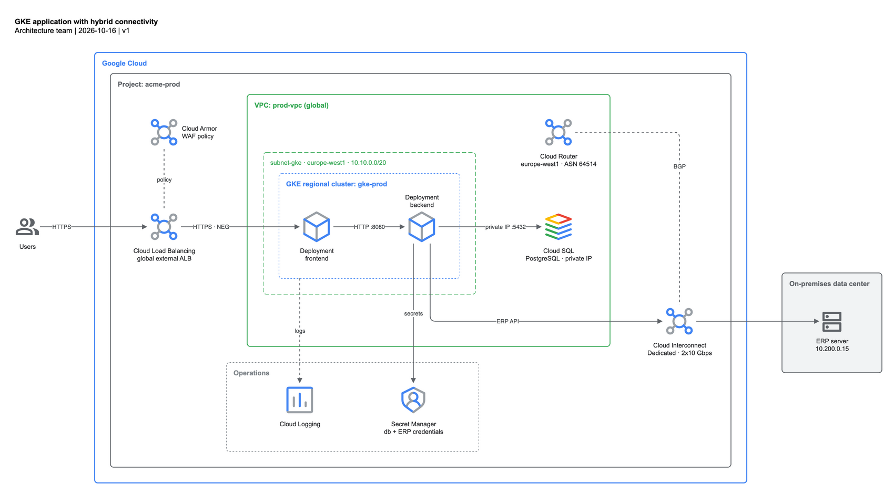

# GKE application with hybrid connectivity

## Flow

1. Users call the application over HTTPS through the global external Application Load Balancer.
   A Cloud Armor security policy (WAF) is attached to its backend service.
2. The load balancer sends traffic to the `frontend` Deployment through container-native NEGs on the
   regional GKE cluster `gke-prod` (europe-west1, subnet `subnet-gke` 10.10.0.0/20).
3. `frontend` calls `backend` inside the cluster (HTTP :8080).
4. `backend` reads and writes Cloud SQL for PostgreSQL over private IP (:5432).
5. `backend` calls the on-premises ERP server (10.200.0.15) through Dedicated Cloud Interconnect.
   Cloud Router exchanges routes with the on-prem router over BGP; it does not carry traffic.
6. `backend` reads database and ERP credentials from Secret Manager.
7. All cluster workloads send logs to Cloud Logging (asynchronous, dashed).

## Services

| Service | Role |
|---|---|
| Cloud Load Balancing (global external ALB) | Global HTTPS entry point, TLS termination |
| Cloud Armor | WAF / DDoS policy on the load balancer |
| GKE regional cluster `gke-prod` | Runs `frontend` and `backend` across europe-west1 zones |
| Cloud SQL (PostgreSQL, private IP) | Transactional database, reachable only from the VPC |
| Cloud Interconnect (Dedicated) | Private link between the VPC and the on-prem data center |
| Cloud Router | Dynamic BGP route exchange for the Interconnect VLAN attachments |
| Secret Manager | Database and ERP credentials |
| Cloud Logging | Centralized logs from the cluster |
| ERP server (on-prem) | System of record called by `backend` |

## Design decisions

- The VPC is global; the subnet, GKE cluster, Cloud Router and Cloud SQL are regional (europe-west1).
  Single region, so the region is carried in the subnet label instead of a separate region box.
- The load balancer and Cloud Armor are global edge services, drawn outside the VPC.
- Cloud SQL private IP lives in a Google-managed producer VPC peered through Private Service Access;
  it is drawn inside the VPC, outside the GKE subnet.
- Cloud Interconnect is a project resource attached to the VPC, drawn between the VPC and the
  on-premises box. Cloud Router sits in the VPC, off the data path, linked to it with a BGP association.
- Secret Manager and Cloud Logging are managed services outside the VPC, in an operations lane below
  the request path.
