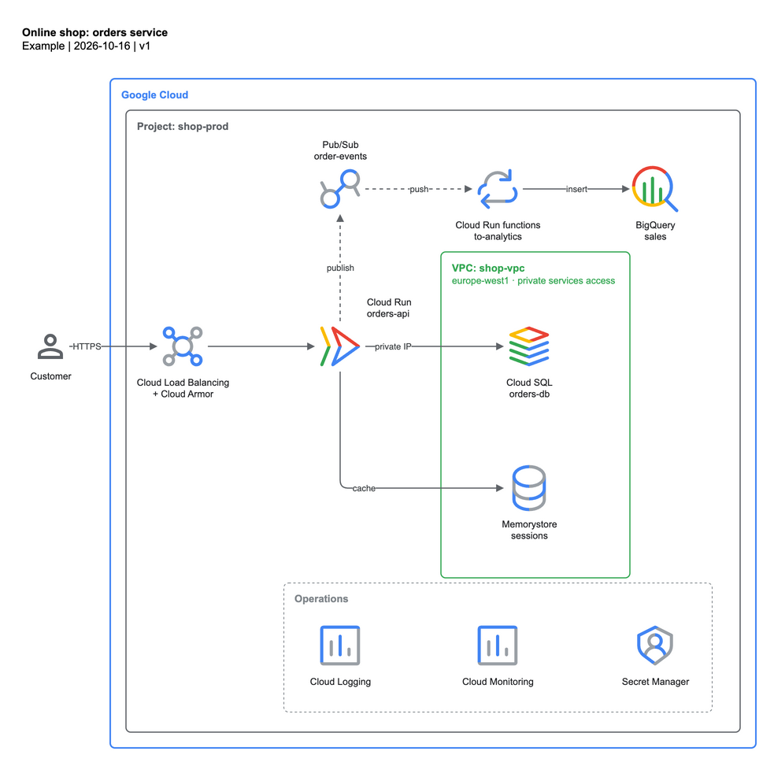

# Online shop: orders service

## Flow

1. The customer calls the shop over HTTPS through the global external Application Load Balancer,
   protected by Cloud Armor.
2. The load balancer routes to the `orders-api` Cloud Run service.
3. `orders-api` reads and writes orders in Cloud SQL over private IP (Direct VPC egress) and keeps
   sessions in Memorystore.
4. Each order is published to the `order-events` Pub/Sub topic.
5. A Cloud Run function consumes the push subscription and inserts the event into BigQuery (`sales`).

## Services

| Service | Role |
|---|---|
| Cloud Load Balancing + Cloud Armor | Global HTTPS entry point, WAF |
| Cloud Run `orders-api` | Stateless API |
| Cloud SQL `orders-db` | Transactional store (private IP) |
| Memorystore `sessions` | Session cache |
| Pub/Sub `order-events` | Decouples analytics from the request path |
| Cloud Run functions `to-analytics` | Event → BigQuery |
| BigQuery `sales` | Analytics |
| Cloud Logging / Monitoring, Secret Manager | Operations |

## Design decisions

- Cloud Run and Pub/Sub are managed services, so they sit in the project, outside the VPC. Cloud SQL and
  Memorystore use private IPs (private services access): they are drawn in the VPC, outside any subnet.
- Analytics is asynchronous (dashed edges): a BigQuery outage never blocks an order.
